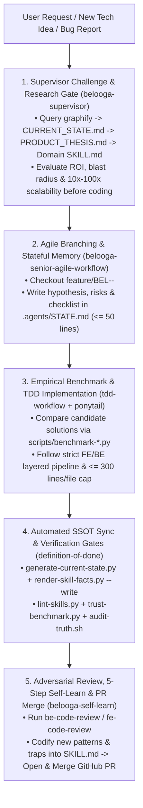
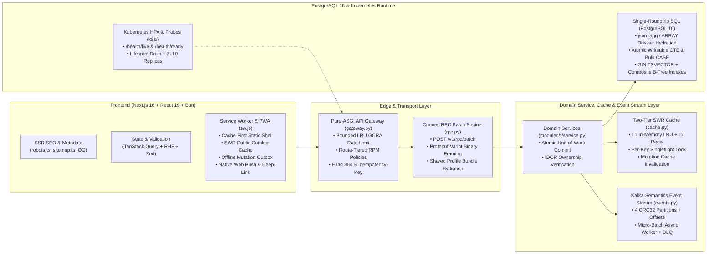

# Agent Router, Architecture Mindmap & Execution Protocol

> **Purpose:** Routes every engineering task through the Adversarial Production Supervisor (`belooga-supervisor`), domain skills, empirical benchmarking, automated truth synchronization, and the Anti-Deception Trust Benchmark.

---

## 1. Master Agent Execution & Continuous Evolution Diagram

---

## 2. Full-Stack Platform Architecture & Scalability Mindmap

---

## 3. Intent-Based Skill Routing Matrix

| Scope / Department | Target Path | Skill |
| :--- | :--- | :--- |
| **Forensic Investigate & Plan (`/investigate`)** | Read-only trace & `.agents/STATE.md` | `investigate` |
| **Production Supervisor & Pushback** | All tasks, ideas & plans | `belooga-supervisor` |
| **All Tasks (Integrity & Evidence)** | All files | `engineering-integrity-and-evidence` |
| **DoD Quality Contract** | All completions & PRs | `definition-of-done` |
| **TDD & Bug Fixes** | Backend / tests / QC | `tdd-workflow` |
| **5-Step Self-Learn & Evolution**| `docs/VIOLATIONS_REGISTER.md`, `.agents/` | `belooga-self-learn` |
| **Senior Agile / Kanban Delivery** | Feature branches, PRs, Kanban tickets | `belooga-senior-agile-workflow` |
| **Default Code Compression** | All code implementations | `ponytail` |
| **UI/UX Design Intelligence** | Design tokens, palettes, UX checklists | `ui-ux-pro-max` |
| **Backend System Standards** | `backend/app/` | `belooga-backend-engineering` |
| **Frontend UI Standards** | `frontend/src/` | `belooga-frontend-engineering` |
| **QC & Playwright Testing** | `qc/` | `belooga-qc-engineering` |
| **Backend Code Review** | Backend PRs / diffs | `be-code-review` |
| **Frontend Code Review** | Frontend PRs / diffs | `fe-code-review` |
| **Backend: Core (Auth, Profile, Timeline, Media)** | `auth.py`, `profile.py`, `timeline.py`, `media.py` | `be-domain-core` |
| **Backend: Discovery (Search, Catalogs, CMS)** | `search.py`, `catalogs.py`, `cms.py` | `be-domain-discovery` |
| **Backend: Monetization (Review, ATS, Jobs, Analytics, MoMo)** | `expert_review.py`, `ats_matching.py`, `job_tracker.py`, `analytics.py`, `payments.py` | `be-domain-monetization` |
| **Frontend: Workspace, Studio & Auth** | `app/user/[username]/*`, `app/(auth)/*` | `fe-domain-workspace` |
| **Frontend: Public, Search & CMS** | `app/page.tsx`, `app/search/`, `app/public/[username]/`, `app/(public)/*` | `fe-domain-public` |
| **Frontend: Career Tools, ATS, Jobs & Analytics** | `app/(public)/expert-review/`, `app/ats-diagnostics/`, `app/cv-studio/`, `app/salary-benchmark/`, `app/workspace/jobs/`, `app/admin/analytics/` | `fe-domain-career-tools` |
| **Code Review for Bloat** | PR review for over-engineering | `ponytail-review` |
| **Repository Bloat Audit** | Whole-repo over-engineering scan | `ponytail-audit` |
| **Technical Debt Ledger** | Track ponytail shortcuts | `ponytail-debt` |

---

## 4. Cross-Domain Impact Matrix & Merge Conditions

When modifying a backend bounded context, verify its downstream frontend dependents:
- **`be-domain-core`:** Verify `fe-domain-workspace` (WebRTC studio, timeline DnD, auth, settings) and `fe-domain-public` (`/public/[username]` video & PDF).
- **`be-domain-discovery`:** Verify `fe-domain-public` (`/search`, `/contact-us`, `/careers`) and `fe-domain-career-tools` (`/salary-benchmark`).
- **`be-domain-monetization`:** Verify `fe-domain-career-tools` (`/expert-review`, `/ats-diagnostics`, `/workspace/jobs`, `/admin/analytics`, MoMo QR checkout).

Merge only when:
1. `python3 scripts/trust-benchmark.py` achieves **100% Trust Score (0 violations)**.
2. CI passes all verification gates: `bash scripts/audit-truth.sh`.
3. `python3 scripts/lint-skills.py --quiet` reports 0 ERROR.
