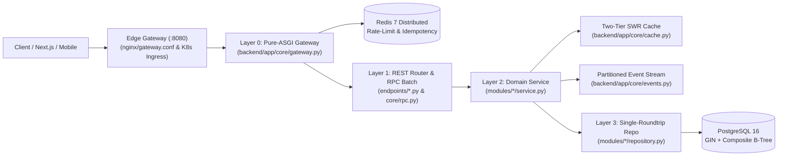

# Belooga Backend Engineering Architecture & Pipeline Protocol

> **Architecture:** High-Throughput Modular Monolith using Pure-ASGI API Gateway, ConnectRPC Batch Multiplexer, Two-Tier L1/L2 SWR Cache, Kafka-Semantics Partitioned Event Stream, SQLAlchemy 2.0 Async (`asyncpg`), and PostgreSQL 16.

---

## 1. Standardized End-to-End Backend Pipeline Flow



1. **Layer 0 — Edge Nginx Gateway (`:8080`) & Distributed Pure-ASGI API Gateway (`backend/app/core/gateway.py`):**
   - Edge reverse proxy (`nginx/gateway.conf` on `:8080` + K8s `Ingress` in `k8s/deployment-and-hpa.yaml`) terminates edge traffic (`100r/s` burst `200`, `15MB` body limit) and routes to `backend:8000`.
   - Zero-copy `__call__(scope, receive, send)` middleware (never use `BaseHTTPMiddleware`) backed by Distributed Redis state (`belooga:gw:rl:*`, `belooga:gw:idem:*`) with Bounded LRU L1 fallback (`AUTH_STRICT_RPM=30`, `MUTATION_RPM=180`, `DEFAULT_RATE_LIMIT_RPM=600`, `CHUNK_UPLOAD_RPM=2400`), `413 Payload Too Large` guard, `Idempotency-Key` replay cache, `ETag` `304 Not Modified`, and unified control-plane telemetry (`/v1/gateway/*`).
2. **Layer 1 — Routers & ConnectRPC Batch Multiplexer (`backend/app/api/v1/endpoints/`, `backend/app/core/rpc.py`):**
   - Thin controllers handling HTTP request parsing, auth injection (`get_current_user`), calling domain services, and returning Pydantic DTOs. Zero raw SQL or direct commits.
   - Multi-widget views use `/v1/rpc/*` batching (`asyncio.gather` + shared profile bundle hydration + optional binary Protobuf-Varint framing `application/x-belooga-rpc-bin`).
3. **Layer 2 — Domain Services, SWR Cache & Event Stream (`backend/app/modules/*/service.py`):**
   - **Unit-of-Work Commit:** Services coordinate business rules, use `await db.flush()` for intermediate entities, and execute a single atomic `await db.commit()` per mutation.
   - **Two-Tier L1/L2 SWR Cache (`backend/app/core/cache.py`):** Read-heavy public endpoints use `platform_cache.get_or_set_swr(key, ttl, stale_ttl, loader)`; mutations MUST call `invalidate_candidate_cache(username)` after `db.commit()`.
   - **Kafka-Semantics Partitioned Event Stream (`backend/app/core/events.py`):** Post-commit side effects (notifications, audit logs, analytics) publish via `await event_stream.publish(topic, key, payload)` into CRC32-partitioned queues with micro-batch drain and Dead-Letter Queue (`dlq`).
4. **Layer 3 — Single-Roundtrip PostgreSQL 16 Repositories (`backend/app/modules/*/repository.py`):**
   - **Zero `N+1` Queries:** Consolidate multi-table reads into a single SQL round-trip using `json_agg(json_build_object(...))` and `ARRAY(SELECT ...)` (e.g., `ProfileRepository.get_full_profile_bundle`).
   - **Atomic Writeable CTEs & Bulk `CASE` Updates:** Use `WITH upserted AS (...) INSERT ... ON CONFLICT DO NOTHING` for tag upserts (`add_skill`), `UPDATE ... RETURNING *` for state transitions (`mark_read`), `COUNT(*) OVER()` window functions for paginated search, and bulk `CASE` `UPDATE` for timeline drag-and-drop (`bulk_update_job_orders`).
5. **Layer 4 — Kubernetes Probes & Graceful Lifespan Drain (`backend/app/main.py`):**
   - `GET /health/live` checks event-loop responsiveness with zero DB queries; `GET /health/ready` verifies PostgreSQL, SWR Cache, and Event Stream readiness; FastAPI `lifespan` drains all partitions cleanly on `SIGTERM`.

---

## 2. Domain Services Map

| Bounded Context | Routers & Services Scope | Domain Skill |
|---|---|---|
| **Core Candidate (Auth, Profile, Timeline, Media)** | `auth.py`, `profile.py`, `timeline.py`, `media.py` (`AuthService`, `ProfileService`, `TimelineService`, `MediaService`, `PdfGenerator`) | `be-domain-core` |
| **Discovery, Catalogs & Public CMS** | `search.py`, `catalogs.py`, `cms.py` (`CatalogsService`, `CmsService`) | `be-domain-discovery` |
| **Monetization, Career Tools & Analytics** | `expert_review.py`, `ats_matching.py`, `job_tracker.py`, `analytics.py`, `payments.py` (`ExpertReviewService`, `ATSMatchingService`, `JobTrackerService`, `AnalyticsService`, `PaymentService`) | `be-domain-monetization` |

---

## 3. System-Wide Invariants
1. **Async Event Loop Non-Blocking:** All synchronous disk I/O, chunk reassembly, and ReportLab PDF builds (`doc.build()`) must execute via `asyncio.to_thread`.
2. **PostgreSQL GIN Search (ADR-005) & Composite B-Tree Indexes:** Full-text search must query `search_vector @@ plainto_tsquery('english', :q)` (never mix with `OR ILIKE`). Every foreign-key + sort query (`identity_id`, `is_read`, `order_status`, `created_at DESC`) must be backed by a composite B-Tree index in `backend/alembic/versions/0004_optimize_indexes_and_sql.py`.
3. **IDOR, RBAC & Zero Anonymous Fallback Protection:** All mutation and private endpoints must authenticate the caller via `get_current_user` (never fallback to `"alexnguyen"` when unauthenticated) and enforce `verify_profile_owner(current_user, target_username)` and strict RBAC (`candidate`, `recruiter`, `expert`, `admin`). Never leave unguarded simulation routes (`/simulate-delivery`, `valid_sim_sig`) open without test-only guards.
4. **Pessimistic Locking, Real PostgreSQL Persistence & Zero Schema Drift:** Timeline reorders and token family rotations must acquire row-level locks via `with_for_update()`, perform a single bulk `CASE` `UPDATE`, and conclude with an explicit `await db.commit()`. Every endpoint in `backend/app/api/v1/endpoints/` must query real PostgreSQL tables (see `CURRENT_STATE.md`) via SQLAlchemy async repositories (never return in-memory seed arrays or static multiplier stubs), and every new table/column in `models/*.py` + `initdb.sql` MUST have a matching Alembic migration in `backend/alembic/versions/`.

---

## 4. Self-Verification & Empirical Benchmarks
```bash
backend/.venv/bin/pytest backend/tests/ -v
backend/.venv/bin/python3 scripts/benchmark-gateway-cache.py
backend/.venv/bin/python3 scripts/benchmark-rpc-and-serialization.py
backend/.venv/bin/python3 scripts/benchmark-event-stream-and-k8s.py
backend/.venv/bin/python3 scripts/benchmark-sql-optimization.py
bash scripts/audit-truth.sh
python3 scripts/lint-skills.py --quiet
```
