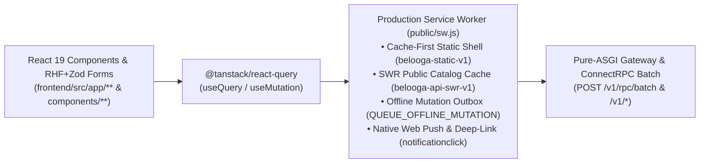

# Belooga Frontend Engineering, PWA Service Worker & SEO Architecture

> **Architecture:** Next.js 16.3.8 (App Router), React 19, Tailwind CSS v4, `@tanstack/react-query`, `react-hook-form` + `zod`, Zustand, Production Service Worker (`public/sw.js`), and Bun runtime.

---

## 1. End-to-End Frontend Data, RPC & Service Worker Flow



---

## 2. Directory Structure & Atomic Modularity
- **`src/app/`:** App Router route boundaries (see `CURRENT_STATE.md` for active inventory) + SEO crawlers (`src/app/robots.ts`, `src/app/sitemap.ts`). Route pages act as thin orchestrators.
- **`src/components/providers/`:** Root providers (`query-provider.tsx`, `service-worker-provider.tsx`) mounted in `src/app/layout.tsx`.
- **`src/components/ui/` & `src/components/common/`:** Atomic primitives (`button.tsx`, `input.tsx`, `dialog.tsx`, `card.tsx`, `badge.tsx`) and reusable molecules (`form-field.tsx`, `confirm-dialog.tsx`, `skill-badge.tsx`, `theme-toggle.tsx`).
- **`src/components/features/`:** Feature-scoped domain organisms (`profile/`, `media/`, `studio/`, `timeline/`, `expert-review/`, `ats-diagnostics/`, `cv-studio/`, `job-tracker/`, `salary-benchmark/`, `analytics/`, `payments/`).
- **`src/components/layout/`:** Global shell components (`Header.tsx`, `Footer.tsx`, `ecosystem-menu.tsx`, `notification-bell.tsx`).
- **`src/hooks/`:** Custom hooks encapsulating client state, device streams, and side effects (`use-candidate-profile.ts`, `use-webrtc-studio.ts`, `use-timeline-dnd.ts`, `use-expert-review.ts`, `use-ats-diagnostics.ts`, `use-job-tracker.ts`, `use-analytics-dashboard.ts`).
- **`src/lib/` & `src/services/`:** Centralized Zod validation schemas (`src/lib/schemas.ts`) synced 1:1 with Backend Pydantic v2 schemas, and HTTP networking client (`src/services/api-client.ts`).
- **`src/store/`:** In-memory client authentication store (`src/store/auth-store.ts`).

---

## 3. State, RPC Batching, Service Worker & SEO Conventions
- **Server State (`@tanstack/react-query` Mandatory) & Zero-Mockup Invariant (`fe_mock_fallback_arrays == 0`):** All API queries and cache invalidations MUST use `@tanstack/react-query` (`useQuery`, `useMutation`, `useQueryClient`) connected 100% to real FastAPI + PostgreSQL `/v1/*` endpoints. **STRICTLY FORBIDDEN from:** (1) calling `apiClient`/`fetch` inside `useEffect`, (2) defining `FALLBACK_*` / `INITIAL_*` / `DEFAULT_*` / `MOCK_*` arrays or `let memory*` RAM stores, (3) using `localStorage` as a fake database when BE is missing, (4) wrapping `apiClient` in `try/catch` to return fallback arrays or fake optimistic success when HTTP 4xx/5xx occurs, (5) using `placeholderData: DEFAULT_*` to mask broken APIs, or (6) hardcoding demo user `"Alex Nguyen"` / `"alexnguyen"` when unauthenticated.
- **ConnectRPC Multiplexed Batching (`/v1/rpc/*`):** Multi-panel pages (such as `src/app/public/[username]/page.tsx`) batch `profile.getPublic`, `profile.getCompleteness`, and `profile.getEndorsements` into a single `/v1/rpc/*` batch request to eliminate N-request waterfalls.
- **Form State & Validation (`react-hook-form` + `zod` Mandatory):** Multi-field forms and modal dialogs MUST use `useForm` with `zodResolver` backed by `src/lib/schemas.ts` and paired with `useMutation`.
- **Production Service Worker & PWA (`public/sw.js` & `public/manifest.webmanifest`):**
  1. **Public API Stale-While-Revalidate (SWR Cache):** Serves instant cached responses while refreshing in the background for public read-only catalog/CMS endpoints (`/v1/catalogs/*`, `/v1/blog/posts`, `/v1/faqs`, `/v1/careers/*`, `/v1/profile/search/trending`, `/v1/match/market-pulse`).
  2. **Strict Auth & Video Stream Bypass:** NEVER cache requests carrying `Authorization` headers or PII routes (`/v1/auth/*`, `/v1/payments/*`, `/v1/notifications/*`), and NEVER cache `206 Partial Content` / `Range` video streams (`.mp4`, `.webm`).
  3. **Offline Mutation Outbox (`useServiceWorker`):** In offline-capable editors (`src/app/cv-studio/page.tsx`), queue saves via `queueOfflineMutation` when `!navigator.onLine` and auto-sync when connectivity returns.
  4. **Native Web Push & Deep-Link Routing:** Dispatch desktop/mobile notifications via `sendNativeNotification` in `src/components/layout/notification-bell.tsx` with `notificationclick` deep-link focus.
  5. **Lie-Fi Timeout & Zero Silent Catch/Cast (`BEL-234` / `NTA-S001`, `NTA-S003`, `NTA-S004`, `NTA-D002`):** Precache via `Promise.allSettled(PRECACHE_ASSETS.map((url) => cache.add(url)))`, guard `fetch(request, { signal: AbortSignal.timeout(8000) })` in `public/sw.js`, set `data-sw-status="error"` on registration failure in `src/components/providers/service-worker-provider.tsx`, type `normalizeMobileUser(raw: MobileUserInput | Record<string, unknown>)` in `mobile/src/store/auth-store.ts`, and maintain `fe_empty_catch_blocks == 0`, `fe_blind_unknown_casts == 0`, `fe_eslint_disable == 0`, and `fe_orphan_components == 0`.
- **SEO & OpenGraph Metadata:** Public pages (`src/app/public/[username]/layout.tsx` and `src/app/(public)/**`) must export canonical URLs, OpenGraph, and Twitter card metadata alongside `src/app/robots.ts` and `src/app/sitemap.ts`.
- **Native Mobile Platform (`mobile/`):** Expo Router screens (`mobile/app/(auth)/{login,register}.tsx`, `mobile/app/(tabs)/{index,studio,tracker,profile}.tsx`, `mobile/app/candidate/[username].tsx`) share 1:1 Zod DTO contracts (`mobile/src/lib/schemas.ts`), semantic RGB/RGBA theme tokens (`mobile/src/theme/tokens.ts`), and singleflight token rotation via `expo-secure-store` (`mobile/src/services/api-client.ts`).

---

## 4. Production Design System & Responsive Standards (`src/app/globals.css`)
- **Zero Arbitrary Hex Invariant (`fe_arbitrary_hex == 0`):** NEVER write raw hex classes (`bg-[#5bbbae]`, `text-[#252525]`). Always bind to Tailwind v4 `@theme` semantic tokens (`bg-brand-primary`, `bg-surface-page`, `bg-surface-card`, `border-surface-border`, `text-typography-main`, `text-typography-heading`, `text-typography-body`, `text-typography-muted`).
- **Dark-Mode Surface Rule:** Never hardcode `bg-white` on cards, dialogs, inputs, badges, or page shells; use `bg-surface-card` or `bg-surface-page`.
- **Zero Structural Emoji Rule (`fe_structural_emoji == 0`):** Never render Unicode emojis in JSX components; always use `lucide-react` SVG icons (`w-4 h-4`, `aria-hidden="true"`).
- **4-Viewport Responsive Contract:** Zero horizontal overflow across Mobile (`375px`, `data-testid="mobile-menu-toggle"` & `data-testid="mobile-nav-drawer"`), Tablet (`768px`), Laptop (`1024px`), and Desktop (`1440px`).

---

## 5. Self-Verification
```bash
cd frontend && bun x tsc --noEmit
cd mobile && bun x tsc --noEmit && bun test
python3 scripts/ratchet.py
backend/.venv/bin/pytest backend/tests/test_ui_design_system_parity.py backend/tests/test_fullstack_seo_gateway.py -v
cd qc && bun run test:e2e
python3 scripts/lint-skills.py --quiet
```
