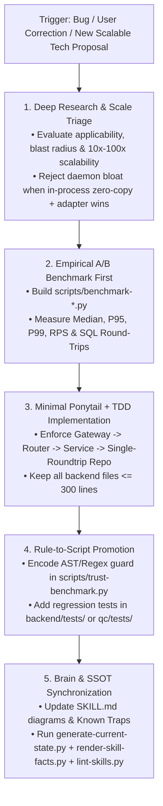

# Belooga 5-Step Continuous Learning, Tech Research & Self-Evolution Protocol

> **Purpose:** Transform runtime incidents, user corrections, debugging discoveries, and new systems engineering knowledge into empirical benchmarks, deterministic code guards, and compressed domain intelligence.

---

## 1. Continuous Learning & Technology Adoption Loop



---

## 2. Trigger Conditions

Activate this protocol immediately when:
1. **User Correction / Pushback:** The user exposes a hallucination, sycophancy, band-aid fix, or unverified assumption.
2. **New Technology / Scalability Evaluation:** The user asks to research and apply systems concepts (e.g., API Gateway, SWR Caching, ConnectRPC/Protobuf-Varint, Kafka Event Streams, Kubernetes HPA/Probes, Service Workers, PostgreSQL 16 Query Consolidation).
3. **Test / Gate Regression:** A pytest, Playwright E2E, typecheck, or `scripts/trust-benchmark.py` gate fails during development.
4. **Non-Obvious Root Cause:** A fix uncovers a deeper architectural trap (e.g. `BaseHTTPMiddleware` double-buffering, `N+1` SQL round-trips, async event-loop blocking, CSS cascade collision, or IDOR gap).
5. **Post-Feature Evolution:** A new feature introduces new routes, models, or architectural patterns that must be synchronized into the harness.

---

## 3. The Mandatory 5-Step Learning & Adoption Structure

Every mistake, optimization, or technology adoption must be analyzed and resolved across all 5 dimensions:

| Step | Question Answered | Concrete Action Required |
|---|---|---|
| **1. Where (Ở đâu)** | Exact file, line range, and architectural layer (`gateway` / `router` / `service` / `repo` / `sw.js` / `hook`). | Pinpoint the exact symbol and call site, never vague descriptions. |
| **2. How, Why & Benchmark (Tại sao & Đo lường)** | What is the exact technical mechanism, bottleneck, or scalability trade-off? | Trace callers (`grep` / `graphify`) and run an empirical A/B benchmark (`scripts/benchmark-*.py`) proving latency/RPS improvement. |
| **3. Minimal Fix / Scalable Apply (Áp dụng tối ưu)** | How do we implement the winning solution with the fewest lines (Ponytail) and highest scale-out readiness? | Use zero-copy/single-roundtrip primitives in-process with clean adapter boundaries for horizontal scaling. |
| **4. Anti-Recurrence Guard (Chặn tái phạm)** | How do we make it physically impossible to regress? | **Rule-to-Script Promotion:** Add an AST/Regex check in `scripts/trust-benchmark.py`, `scripts/audit-truth.sh`, or a TDD suite in `backend/tests/`. |
| **5. Self-Upgrade (Tự tiến hóa)** | How does the agent upgrade its own brain for future tasks? | Update architecture diagrams and `## Known Traps` in `.agents/skills/*/SKILL.md`, log severe traps in `docs/VIOLATIONS_REGISTER.md`, and update `.agents/PRODUCT_THESIS.md` (<= 120 lines). |

---

## 4. Destination Routing & Rule-to-Script Promotion

> **Iron Law:** Prose rules in Markdown can be forgotten by LLMs; exit code `1` in Python/Bash cannot. Always prefer promoting a lesson into an executable check.

| Discovery Type | Target Destination | Mandatory Action |
|---|---|---|
| **Band-Aid / Deception / Anti-Pattern** | `scripts/trust-benchmark.py` or `scripts/audit-truth.sh` | Encode an AST or regex detector so future commits fail automatically. |
| **Performance / Architecture Benchmark** | `scripts/benchmark-*.py` & `.agents/skills/belooga-*-engineering/SKILL.md` | Commit reproducible benchmark script and document winning pattern in the engineering skill. |
| **Code Bloat / Type Evasion Improvement** | `.agents/ratchet.json` | Run `python3 scripts/ratchet.py --update` to lock in the lower baseline. |
| **New Route / Table / Schema Added** | `.agents/skills/*/SKILL.md` & `CURRENT_STATE.md` | Run `python3 scripts/generate-current-state.py --allow-dirty && python3 scripts/render-skill-facts.py --write`. |
| **Domain-Specific Trap** | `.agents/skills/{be-domain-*,fe-domain-*}/SKILL.md` | Add a 1-2 line bullet under `## Known Traps` (keep skill <= 200 lines). |
| **Business / UX / Human Insight** | `.agents/PRODUCT_THESIS.md` | Add insight and evict/compress old lines to stay <= 120 lines. |
| **Severe Hallucination / UI Distortion** | `docs/VIOLATIONS_REGISTER.md` | Append `[VIOLATION-XXX]` with the 5-step breakdown. |

---

## 5. Verification & Sign-Off

After executing a self-learn or architecture upgrade, always run:
```bash
python3 scripts/generate-current-state.py --allow-dirty
python3 scripts/render-skill-facts.py --write
python3 scripts/lint-skills.py --quiet
python3 scripts/trust-benchmark.py
bash scripts/audit-truth.sh
```
Output a concise summary mapping strictly to: **Where -> How/Why (Benchmark) -> Minimal Scalable Apply -> Automated Guard -> Brain Upgrade**.
