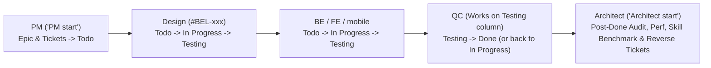

# Multi-Agent GitHub Kanban Delivery Protocol (`Kanban Belooga`)

> **Core Philosophy:** The User interacts **ONLY with PM (`"PM start"`)**. PM orchestrates all team members (`Design`, `BE`, `FE`, `mobile`, `QC`, `Architect`) through GitHub Issues and the **Kanban Belooga** GitHub Project Board (`https://github.com/users/farmer911/projects/1`). Every agent listens to GitHub signals, clears working memory before starting a new ticket, logs its active ticket on every session, and synchronizes both Issue Labels and Project Board Columns.



---

## 1. Mandatory Rules for Every Team Member (`Design`, `BE`, `FE`, `mobile`, `QC`, `Architect`)

1. **Mandatory Session Ticket Header (Ghi Nhận Ticket Trên Phiên Làm Việc):**
   - Whenever an agent starts or works on a ticket, it **MUST** print at the top of its chat session, record in `.agents/STATE.md`, and comment on the GitHub Issue:
     ```text
     🎯 Đang làm ticket: [BEL-xxx] (#<issue_number>) — <Ticket Title> | Role: <Role> | Cột: <Todo | In Progress | Testing | Done>
     ```
2. **Clear Memory to Save Tokens:**
   - Immediately upon picking a new ticket, clear old context in `.agents/STATE.md` (strictly `<= 50` lines) before starting work.
3. **Never Stop Listening (Silent Background Watcher `scripts/watch-kanban.sh`) & Zero Polling Spam:**
   - **Step 0 (Mandatory Failing-PR Check & Zero-Mockup / BE-First Gate):** Before picking any new `status:todo` feature ticket, `BE`, `FE`, and `mobile` **MUST** check `gh pr list --state open --json number,headRefName,statusCheckRollup` and prioritize any `[P0-CI-FIX]` ticket or any open PR of their role that has `FAILURE` in `statusCheckRollup`. **STRICTLY FORBIDDEN from writing mock/fallback arrays (`FALLBACK_*`, `INITIAL_*`, `DEFAULT_*`, `MOCK_*`), `localStorage` fake DBs, or `catch { return mock }` in `frontend/src/` or `mobile/src/`.** Every `FE` and `mobile` feature MUST call a real, live FastAPI + PostgreSQL endpoint in `backend/app/api/v1/endpoints/`; if the paired `BE` ticket has not merged yet, wait for `BE` to merge first—never fake the backend!
   - **Never Move to `Testing` Before CI Green & Real BE Integration:** Do not transition a ticket to `status:testing` until `gh pr checks <PR> --watch` passes 100% green AND all `/v1/*` endpoints called by `FE`/`mobile` actually exist in `backend/app/api/v1/endpoints/`. If `QC` detects a failing PR or ANY mock/fallback array (`FALLBACK_*`, `INITIAL_*`, `catch` fallback) or missing BE endpoint in `Testing`, `QC` **MUST** reject it back to **`Todo`** (`b5bd229a` / `status:todo`) immediately.
   - **STRICT BAN ON `schedule` TOOL FOR POLLING (Use `scripts/watch-kanban.sh` Instead):** Agents are **STRICTLY FORBIDDEN** from calling `schedule(DurationSeconds=30)` to poll GitHub (which causes 30s LLM wakeup spam and token repetition loops). When no actionable ticket/PR is ready, ALWAYS call `run_command(CommandLine="bash scripts/watch-kanban.sh <design|be|fe|mobile|qc|architect>", WaitMsBeforeAsync=500, IsDaemon=False)` which sleeps silently in bash and ONLY exits (waking up the agent) when real work arrives. **NEVER** output `⏳ [...] Đang chờ...` or `"Let's stop here / Let's end turn"`.

---

## 2. The 4-Column `Kanban Belooga` Board & Signal Protocol

- **GitHub Project Board:** `Kanban Belooga` (`Project #1` | `Project ID: PVT_kwHOAeXQP84BoMSn` | `Status Field ID: PVTSSF_lAHOAeXQP84BoMSnzhmthEM`)
- **4 Columns (Must update BOTH Issue Label and Project Board Status):**
  1. **`Todo`** (`optionId: b5bd229a` | label `status:todo`):
     - `Design` (`role:design`), `BE` (`role:backend`), `FE` (`role:frontend`), `mobile` (`role:mobile`) listen for tickets matching their role label + `status:todo`.
  2. **`In Progress`** (`optionId: ef71cae9` | label `status:in-progress`):
     - Upon picking a ticket, move label to `status:in-progress` and board column to `In Progress`.
     - Implement on branch `feature/BEL-<id>-<slug>` following TDD (`Red -> Green -> Ponytail`), open PR, attach PR & test output to the issue, then move to **`Testing`**.
  3. **`Testing`** (`optionId: 7bd84c2d` | label `status:testing` — **Dedicated QC Column**):
     - **QC does NOT use standalone QC tickets in `Todo`.**
     - **QC listens and works exclusively on the `Testing` column.** When any ticket enters `Testing`, `QC` claims it, logs `🎯 Đang làm ticket: [BEL-xxx] (#<id>) | Role: QC | Cột: Testing`, verifies PR + E2E gates (`cd qc && bun run test:e2e`, `audit-truth.sh`, `e2e-mobile-adb.sh`).
  4. **`Done`** (`optionId: 34367ba5` | label `status:done`):
     - When **QC test done (Pass 100%)**, `QC` moves the ticket from `Testing` to **`Done`**.
     - If QC finds any defect, `QC` posts exact failure traces on the ticket/PR and moves it back to **`In Progress`** (`ef71cae9` / `status:in-progress`).

**CLI Command to Move Card on `Kanban Belooga` Board:**
```bash
# Add issue to board (returns ITEM_ID):
gh project item-add 1 --owner farmer911 --url https://github.com/farmer911/belooga/issues/<ISSUE_NUMBER> --format json
# Move card across columns (Todo=b5bd229a, In Progress=ef71cae9, Testing=7bd84c2d, Done=34367ba5):
gh project item-edit --id <ITEM_ID> --project-id PVT_kwHOAeXQP84BoMSn --field-id PVTSSF_lAHOAeXQP84BoMSnzhmthEM --single-select-option-id <OPTION_ID>
```

---

## 3. `"PM start"` — PM Orchestrator Protocol

When the user says **`"PM start"`** (or gives ANY feature/bug/update request to PM):
1. **Strictly NO-CODE for PM (Single Point of Contact):** The user only talks to PM. **PM NEVER writes or modifies application code.** Whenever the user asks PM to build, fix, or update anything, PM only performs read-only root-cause inspection, creates structured GitHub Issues (`[BEL-xxx]`), and places them on the **Kanban Belooga** Board (`Todo` column `b5bd229a`) so `Design`, `BE`, `FE`, `mobile`, `QC`, and `Architect` execute autonomously.
2. **Epic & Ticket Chain Creation:**
   - Create Parent Epic `[EPIC-xxx]` (`Epic,type:epic,status:in-progress`) containing full Business Thesis (`.agents/PRODUCT_THESIS.md`), DB/API Contracts (`CURRENT_STATE.md`), and ISO Ticket Chain.
   - Create role tickets (`[BEL-xxx]`) in strict dependency order:
     * `Design` (`Design,role:design,status:todo,type:task`) — runs first to lock UX layout, `@theme` semantic tokens (`fe_arbitrary_hex == 0`), `lucide-react` icons (`fe_structural_emoji == 0`), and `375px` parity.
     * `BE` (`BE,role:backend,status:todo,type:task`), `FE` (`FE,role:frontend,status:todo,type:task`), `mobile` (`mobile,role:mobile,status:todo,type:task`) — linked to the Epic and Design spec.
     * `Architect` (`Architect,role:architect,status:todo,type:task`) — triggered after all implementation tickets reach `Done`.
   - Attach every created issue to `Kanban Belooga` (`gh project item-add 1 --owner farmer911 ...`) and set initial column to `Todo` (`b5bd229a`).

---

## 4. `"Architect start"` — System Architect Protocol

When the user says **`"Architect start"`**:
1. **Continuous GitHub Listener:** Poll GitHub Issues/Board for `Architect` (`role:architect`) tickets and monitor when Epic implementation tickets reach `Done` (`status:done`).
2. **Clear Memory First:** Reset `.agents/STATE.md` (`<= 50` lines) before starting each ticket and log `🎯 Đang làm ticket: [BEL-xxx] (#<id>) | Role: Architect | Cột: In Progress`.
3. **Full Architect Authority & Mandatory Anti-Recurrence Loop:**
   - **Mandatory Reverse Ticket Creation (Bắt Buộc Tạo Ticket Cho Team Fix):** Whenever Architect discovers ANY bug, missing endpoint, or deception/cheating behavior during an audit, Architect **MUST NEVER just write a report and close the ticket**. Architect **MUST immediately run `gh issue create`** to create concrete `[BEL-xxx]` reverse tickets in the **`Todo`** column (`b5bd229a` / `status:todo`) assigned to `BE`, `FE`, `mobile`, `Design`, or `QC` for every single defect found.
   - **Mandatory Skill & Benchmark Upgrade (Cập Nhật Skill Để Không Tái Phạm):** Every time a bug or deception pattern is found, Architect **MUST** update the corresponding domain `SKILL.md` (`belooga-frontend-engineering`, `belooga-backend-engineering`, `belooga-qc-engineering`, `fe-domain-*`, `be-domain-*`), `docs/VIOLATIONS_REGISTER.md`, and `scripts/trust-benchmark.py` so the violation is permanently blocked in CI and agents never repeat it.
   - **Performance & Ponytail Refactor:** Optimize BE (indexes, 0 N+1, p95 `< 30ms`, Singleflight cache) and FE/Mobile (`@tanstack/react-query` cache invalidation, `<= 300` lines/file).
   - **Skill Upgrade & Mandatory Benchmark:** Whenever updating `.agents/skills/*/SKILL.md`, `.agents/PRODUCT_THESIS.md`, or `.agents/ratchet.json`, MUST run and record:
     ```bash
     python3 scripts/generate-current-state.py && python3 scripts/render-skill-facts.py --write
     python3 scripts/lint-skills.py --quiet && python3 scripts/trust-benchmark.py
     ```

---

## 5. `"QC start"` — Dedicated QC Channel Protocol

When the user says **`"QC start"`** (or opens the dedicated `QC` channel):
1. **Continuous `Testing` Column & Open PR Listener:** Continuously poll `gh issue list --state open --label "status:testing"` and `gh pr list --state open --json number,headRefName,statusCheckRollup`.
2. **Transparent Live Channel Reporting:** Clear `.agents/STATE.md` (`<= 50` lines) per ticket and print at the top of the QC chat + GitHub comment:
   `🎯 Đang làm ticket: [BEL-xxx] (#<id>) — <Title> | Role: QC | Cột: Testing`
3. **Strict Pass / Reject Execution:**
   - **If CI + E2E (`cd qc && bun run test:e2e`, `python3 scripts/trust-benchmark.py`, or `e2e-mobile-adb.sh`) PASS 100%:** Merge the PR (`gh pr merge <PR> --squash --delete-branch`), move the ticket from `Testing` to **`Done`** (`34367ba5` / `status:done`), and output in the QC channel: `✅ [QC PASS] #<id> ([BEL-xxx]) — PR #<pr> xanh 100%, đã merge & chuyển sang Done`.
   - **If CI or E2E FAILS:** Post exact failure logs (`gh run view <run_id> --log-failed`) on the Issue & PR, move the ticket back to **`Todo`** (`b5bd229a` / `status:todo`) so `BE`/`FE`/`mobile` fixes it immediately, and output in the QC channel: `❌ [QC FAIL] #<id> ([BEL-xxx]) — PR #<pr> lỗi <lý do>, đã trả về cột Todo`.
   - **Silent Waiting (NO `schedule`):** When all open PRs are still running CI (`IN_PROGRESS`) or `Testing` is empty, call `run_command(CommandLine="bash scripts/watch-kanban.sh qc", WaitMsBeforeAsync=500, IsDaemon=False)` so `watch-kanban.sh` waits silently in bash until a PR finishes CI (`MERGEABLE`/`FAILURE`/`CONFLICTING`). NEVER call `schedule` and NEVER output `⏳ [QC] Đang chờ...`.
